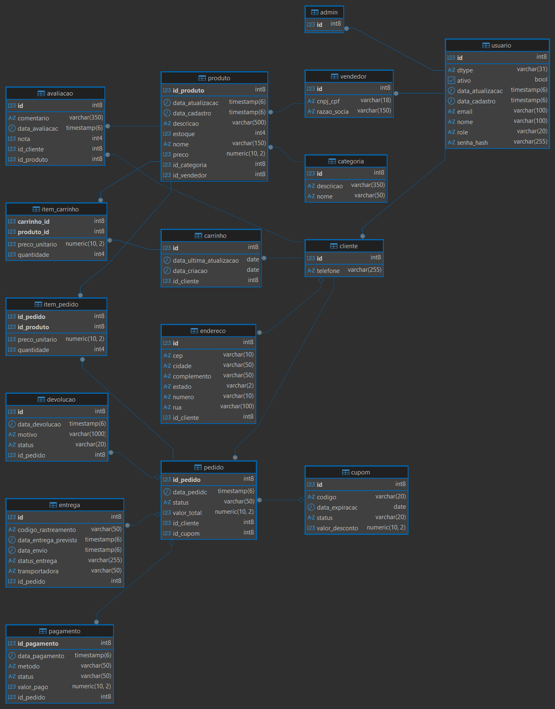

# 🚀 Desenvolvimento e Aplicações Web II - Projeto Marketplace

Este repositório contém o projeto prático da disciplina de **Desenvolvimento e Aplicações Web II** do curso de Análise e Desenvolvimento de Sistemas (ADS) - IFPB. O projeto evoluiu do mapeamento objeto-relacional inicial (JPA) para uma **API REST completa de marketplace (e-commerce)**, com autenticação, regras de negócio e persistência em banco de dados.

---

## 📖 Sobre o Projeto

A aplicação é uma API REST que gerencia as operações de um marketplace, conectando clientes e vendedores. O projeto iniciou com o **Mapeamento Objeto-Relacional (ORM)** de um modelo de dados desenvolvido na disciplina de Banco de Dados I, utilizando JPA/Hibernate, e evoluiu para uma arquitetura em camadas (controller → service → repository), com autenticação JWT, controle de acesso baseado em perfis e validação de propriedade dos recursos.

---

## 🛠️ Tecnologias Utilizadas

* **Linguagem:** Java 17+
* **Framework:** Spring Boot
* **Persistência:** Spring Data JPA / Hibernate
* **Banco de dados:** PostgreSQL (via Docker Compose)
* **Segurança:** Spring Security com autenticação JWT (jjwt)
* **Mapeamento DTO:** MapStruct
* **Documentação:** Swagger / OpenAPI (springdoc)
* **Build Tool:** Maven

---

## 🏗️ Estrutura e Padrões Implementados

### 1. Camada de Modelo (`model`)
Entidades JPA com `equals()`/`hashCode()` baseados apenas no identificador e `toString()` sem relacionamentos, evitando recursão infinita entre entidades bidirecionais.

### 2. Camada de Persistência (`repository`)
Repositórios Spring Data por entidade, com consultas JPQL para filtros opcionais e listagens restritas ao usuário logado.

### 3. Camada de Serviço (`service`)
Todas as regras de negócio ficam nos serviços: cálculo do valor do pedido, controle de estoque, transições de status, unicidade de dados e verificação de que o usuário logado é dono do recurso (`UsuarioAutenticadoService`).

### 4. Camada REST (`rest`)
Controllers finos, DTOs de requisição e resposta, paginação nas listagens, documentação Swagger e tratamento global de erros no padrão `ProblemDetail`.

### 5. Segurança e Autenticação
* **Login:** `POST /auth/login` retorna um token JWT.
* **Filtro JWT:** `JwtAuthenticationFilter` autentica cada requisição de forma stateless.
* **Perfis:** `ADMIN`, `VENDEDOR` e `CLIENTE`, verificados com `@PreAuthorize`.
* **Propriedade:** além do perfil, a API verifica se o recurso pertence ao usuário logado (um cliente só vê e altera os próprios pedidos, endereços, carrinho e avaliações; um vendedor só altera os próprios produtos e só acessa pedidos que contêm produtos seus).
* **Rotas públicas:** `/auth/login`, `POST /clientes`, `POST /vendedores` e Swagger.

### 6. Seed de Dados
* **Admin padrão** criado automaticamente no primeiro boot.
* `POST /seed/popular`, `DELETE /seed/limpar` e `POST /seed/resetar` (restritos a ADMIN) geram dados de teste coerentes com as regras de negócio.

---

## 🔄 Fluxo de Compra

| Etapa | Endpoint | Quem | Regra |
| :--- | :--- | :--- | :--- |
| 1. Criar pedido | `POST /pedidos` | Cliente | Cupom precisa estar ATIVO e dentro da validade. Pedido nasce `CRIADO` com total zero. |
| 2. Adicionar itens | `POST /itens-pedido` | Cliente | Só em pedido `CRIADO`. Preço vem do produto. Quantidade ≤ estoque. Total é recalculado (itens − desconto do cupom). |
| 3. Confirmar | `PATCH /pedidos/{id}/fechar` | Cliente | Precisa ter itens. Baixa o estoque. Status `CONFIRMADO`. |
| 4. Pagar | `POST /pagamentos` | Cliente | Só pedido `CONFIRMADO`. Valor pago = total do pedido. Status `PENDENTE`. |
| 5. Aprovar pagamento | `PATCH /pagamentos/{id}/confirmar` | Vendedor/Admin | Só pagamento `PENDENTE` → `APROVADO`. |
| 6. Enviar | `POST /entregas` | Vendedor/Admin | Só com pagamento `APROVADO`. Uma entrega por pedido. Começa `EMBALADO`. |
| 7. Atualizar entrega | `PATCH /entregas/{id}/status` | Vendedor/Admin | Status só avança: `EMBALADO` → `EM_TRANSITO` → `SAIU_PARA_ENTREGA` → `ENTREGUE`. |
| 8. Avaliar | `POST /avaliacoes` | Cliente | Só produtos de pedidos `CONFIRMADOS`, uma avaliação por produto. |
| 9. Devolver | `POST /devolucoes` | Cliente | Só pedido `ENTREGUE`, uma devolução ativa por pedido. |
| 10. Aprovar devolução | `PATCH /devolucoes/{id}/aprovar` | Vendedor/Admin | Pedido vira `DEVOLVIDO`, pagamento `ESTORNADO` e o estoque é devolvido. |

**Cancelamento:** `PATCH /pedidos/{id}/cancelar` só é permitido para pedidos `CRIADOS` ou `CONFIRMADOS` que ainda não foram enviados. O estoque é devolvido e o pagamento vira `ESTORNADO` (se aprovado) ou `RECUSADO` (se pendente).

---

## ❗ Códigos de Resposta

| Código | Quando |
| :--- | :--- |
| `400` | Dados inválidos (validação, JSON malformado, parâmetros incorretos) |
| `401` | Sem token, token inválido/expirado ou login incorreto |
| `403` | Perfil sem permissão ou recurso de outro usuário |
| `404` | Entidade não encontrada |
| `409` | Duplicidade (e-mail, CNPJ, código) ou registro em uso por outros dados |
| `422` | Operação não permitida no estado atual (ex.: pagar pedido não confirmado) |

---

## 🔐 Credenciais do Admin Padrão

| Campo | Valor |
| :--- | :--- |
| E-mail | `admin@marketplace.com` |
| Senha | `admin123` |

Após `POST /seed/popular`, também existem `cliente1@email.com` … `cliente50@email.com` e `vendedor1@eletronicos.com` … (senha `senha123`).

---

## ⚙️ Configuração do Ambiente

O arquivo `src/main/resources/application.properties` **não é versionado**. Crie-o a partir do modelo:

```bash
cp application.properties.example src/main/resources/application.properties
```

O modelo já aponta para o PostgreSQL do `docker-compose.yml` (porta `5433`, banco `marketplace`, usuário e senha `postgres`). Os valores podem ser sobrescritos pelas variáveis de ambiente `DB_URL`, `DB_USERNAME`, `DB_PASSWORD`, `JWT_SECRET` e `JWT_EXPIRATION`.

---

## ▶️ Como Executar

1. Suba o banco: `docker compose up -d`
2. Crie o `application.properties` (seção acima).
3. Suba a aplicação: `mvn spring-boot:run`
4. Acesse o Swagger: `http://localhost:8080/swagger-ui/index.html`
5. Faça login em `POST /auth/login` com o admin padrão, copie o token e clique em **Authorize**.
6. Use `POST /seed/popular` para carregar dados de teste.

---

## 🗺️ Modelo de Dados

Abaixo, a representação visual do modelo conceitual do projeto, desenvolvido na disciplina de Banco de Dados I:



---

**Desenvolvido por:** Lucas Barbosa, Paulo Moura e Valdênio Pantaleão,
Estudantes de ADS 4° período - IFPB
